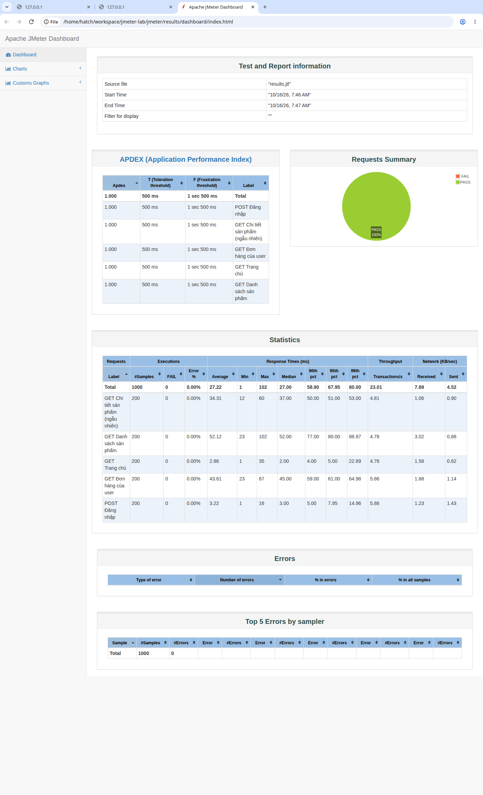
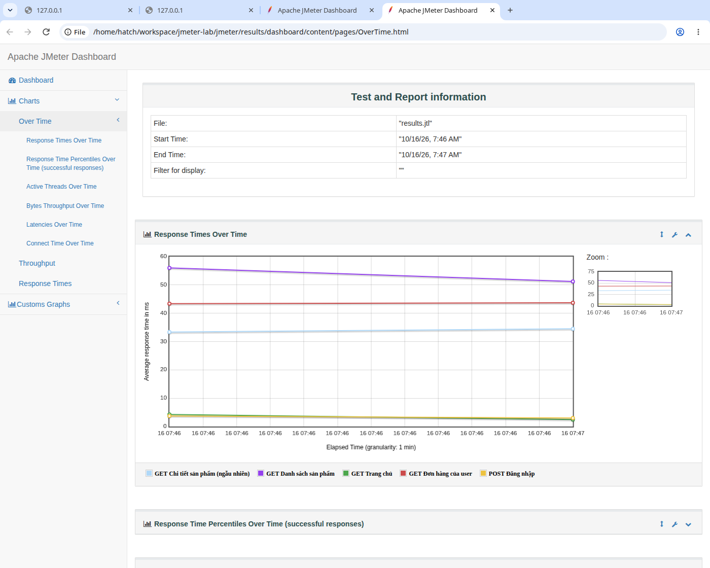

# Báo cáo thực hành: Học công cụ kiểm thử hiệu năng Apache JMeter

> Môn: Kiểm định & Chất lượng Phần mềm — Bài thực hành công cụ JMeter
> Người thực hiện: Đỗ Trần Anh Sơn
> Repo: https://github.com/asotaku205/jmeter-lab

## 1. Mục tiêu

- Tìm hiểu và sử dụng thành thạo các thành phần cốt lõi của **Apache JMeter**: Test Plan, Thread Group,
  Sampler, Config Element, Timer, Assertion, Listener.
- Xây dựng một kịch bản kiểm thử hiệu năng hoàn chỉnh cho một ứng dụng web demo.
- Thực thi kiểm thử, thu thập số liệu (response time, throughput, error rate) và sinh báo cáo dashboard.

## 2. Môi trường thực hiện

| Thành phần | Phiên bản / Thông tin |
|---|---|
| Apache JMeter | 5.6.3 |
| Java | OpenJDK 17 (chạy với `-Djava.net.preferIPv4Stack=true`) |
| Ứng dụng demo | Demo Shop API (Flask, Python) chạy tại `http://127.0.0.1:5001` |
| Hệ điều hành | Ubuntu (máy lab) |

## 3. Đối tượng kiểm thử: Demo Shop API

Ứng dụng web demo mô phỏng một cửa hàng trực tuyến đơn giản, gồm các endpoint:

| Endpoint | Method | Mô tả |
|---|---|---|
| `/` | GET | Trang chủ (HTML) |
| `/api/products` | GET | Danh sách 8 sản phẩm (JSON) |
| `/api/products/{id}` | GET | Chi tiết một sản phẩm (JSON), 404 nếu không tồn tại |
| `/api/login` | POST | Đăng nhập bằng JSON `{username, password}`, trả về `token` |
| `/api/orders?user={u}` | GET | Danh sách đơn hàng của user (JSON) |
| `/health` | GET | Kiểm tra trạng thái ứng dụng |

Mã nguồn ứng dụng nằm trong thư mục [`demo-app/`](demo-app/).

## 4. Kịch bản kiểm thử (`jmeter/DemoShop_TestPlan.jmx`)

### 4.1. Cấu trúc Test Plan

```
Kiểm thử hiệu năng - Demo Shop API (Test Plan)
├── HTTP Header Manager                    # Header chung: Accept + Content-Type = application/json
├── TG01 - Luồng xem sản phẩm              # 20 threads, ramp-up 20s, lặp 10 lần
│   ├── HTTP Request Defaults              # Server mặc định: 127.0.0.1:5001
│   ├── GET Trang chủ                      # /
│   │   ├── Assert - Response code 200
│   │   └── Assert - Trang chứa 'Demo Shop'
│   ├── GET Danh sách sản phẩm             # /api/products
│   │   ├── Assert - Response code 200
│   │   └── Assert - Response time < 2000ms (Duration Assertion)
│   ├── GET Chi tiết sản phẩm (ngẫu nhiên) # /api/products/${__Random(1,8)}
│   │   └── Assert - Response code 200
│   ├── Think Time                          # Gaussian Random Timer: nghỉ ~800ms ± 400ms
│   └── View Results Tree                  # Xem chi tiết từng request khi debug
├── TG02 - Luồng đăng nhập & đơn hàng     # 20 threads, ramp-up 20s, lặp 10 lần
│   ├── HTTP Request Defaults
│   ├── CSV Data Set Config                # Đọc 10 tài khoản từ test-data/users.csv
│   ├── POST Đăng nhập                     # /api/login với ${username}/${password}
│   │   ├── Assert - Response code 200
│   │   └── Assert - Response chứa 'token'
│   ├── GET Đơn hàng của user             # /api/orders?user=${username}
│   │   ├── Assert - Response code 200
│   │   └── Assert - Response time < 2000ms
│   └── Think Time
└── Aggregate Report                       # Tổng hợp số liệu, ghi ra results/aggregate.csv
```

Tổng cộng: **40 user ảo**, mỗi user lặp 10 lần → **1000 requests**.

### 4.2. Các khái niệm JMeter đã áp dụng

| Thành phần | Vai trò trong bài này |
|---|---|
| **Thread Group** | Mô phỏng nhóm người dùng đồng thời; cấu hình số thread, thời gian ramp-up, số vòng lặp |
| **HTTP Request** (Sampler) | Gửi request GET/POST tới từng endpoint |
| **HTTP Request Defaults** (Config) | Khai báo server/port một lần, các sampler kế thừa |
| **HTTP Header Manager** (Config) | Gửi header chung cho mọi request |
| **CSV Data Set Config** (Config) | Tham số hóa dữ liệu đầu vào (10 tài khoản đăng nhập) |
| **Gaussian Random Timer** (Timer) | Mô phỏng thời gian "suy nghĩ" của user giữa các thao tác |
| **Response Assertion** | Kiểm tra mã trạng thái và nội dung response (pass/fail từng sample) |
| **Duration Assertion** | Fail nếu response time vượt ngưỡng 2000ms |
| **View Results Tree / Aggregate Report** (Listener) | Xem chi tiết và tổng hợp kết quả |
| **HTML Dashboard Report** | Báo cáo đồ họa sinh từ file `.jtl` (`jmeter -g results.jtl -o dashboard/`) |

### 4.3. Giao diện JMeter mở Test Plan


## 5. Thực thi và kết quả

### 5.1. Lệnh chạy (headless)

```bash
cd jmeter
JVM_ARGS="-Djava.net.preferIPv4Stack=true" \
  ../apache-jmeter-5.6.3/bin/jmeter -n -t DemoShop_TestPlan.jmx \
  -l results/results.jtl -e -o results/dashboard
```

### 5.2. Kết quả console

```
summary =   1000 in 00:00:44 =   22.8/s Avg:    27 Min:     1 Max:   102 Err:     0 (0.00%)
```

→ **1000 requests trong 44 giây, throughput ~22.8 req/s, tỉ lệ lỗi 0.00%** — mọi assertion đều pass.

### 5.3. Bảng số liệu chi tiết (từ HTML Dashboard)

| Sampler | #Samples | Avg (ms) | Min | Max | p90 | p95 | Error % |
|---|---:|---:|---:|---:|---:|---:|---:|
| GET Trang chủ | 200 | 2.9 | 1 | 35 | 4 | 5 | 0.00% |
| GET Danh sách sản phẩm | 200 | 52.1 | 23 | 102 | 77 | 80 | 0.00% |
| GET Chi tiết sản phẩm (ngẫu nhiên) | 200 | 34.3 | 12 | 60 | 50 | 51 | 0.00% |
| POST Đăng nhập | 200 | 3.2 | 1 | 16 | 5 | 8 | 0.00% |
| GET Đơn hàng của user | 200 | 43.6 | 23 | 67 | 59 | 61 | 0.00% |
| **Total** | **1000** | **27.2** | **1** | **102** | **58.9** | **68.0** | **0.00%** |

Chỉ số **APDEX = 1.000** cho tất cả sampler (ngưỡng hài lòng 500ms) — mức tối đa.



### 5.4. Biểu đồ Response Times Over Time



Biểu đồ cho thấy response time trung bình của từng endpoint **ổn định trong suốt quá trình test**,
không có hiện tượng tăng đột biến khi số lượng user ảo tăng dần (ramp-up) — dấu hiệu hệ thống
chịu tải tốt ở mức 40 concurrent users.

## 6. Nhận xét và kết luận

1. **Chức năng đúng**: 100% request pass assertion — mọi endpoint trả về đúng mã trạng thái,
   đúng nội dung (token khi đăng nhập, "Demo Shop" ở trang chủ) và đều dưới ngưỡng 2000ms.
2. **Hiệu năng tốt**: response time trung bình 27ms, p95 chỉ 68ms — rất xa ngưỡng 2000ms;
   APDEX đạt 1.000 tuyệt đối.
3. **Ổn định dưới tải**: với 40 user ảo đồng thời trong 44 giây, throughput duy trì ~23 req/s,
   không ghi nhận lỗi hay timeout nào.
4. **Điểm cần lưu ý**: endpoint `/api/products` (52ms) và `/api/orders` (44ms) chậm hơn hẳn
   các endpoint còn lại do có độ trễ xử lý mô phỏng — đây là ứng cử viên tối ưu đầu tiên
   nếu muốn nâng throughput.

**Kết luận**: Demo Shop API đáp ứng tốt ở mức tải kiểm thử (40 concurrent users).
Bài thực hành đã bao quát đầy đủ vòng đời kiểm thử hiệu năng bằng JMeter:
thiết kế kịch bản → tham số hóa dữ liệu → thực thi → phân tích báo cáo.

## 7. Cách chạy lại

```bash
# 1. Khởi động app demo
cd demo-app
pip install -r requirements.txt
python app.py          # chạy tại http://127.0.0.1:5001

# 2. Mở test plan bằng JMeter GUI (tuỳ chọn)
jmeter -t jmeter/DemoShop_TestPlan.jmx

# 3. Chạy kiểm thử headless + sinh báo cáo HTML
cd jmeter
JVM_ARGS="-Djava.net.preferIPv4Stack=true" \
  jmeter -n -t DemoShop_TestPlan.jmx -l results/results.jtl -e -o results/dashboard
# Mở results/dashboard/index.html để xem báo cáo
```

## 8. Cấu trúc thư mục

```
jmeter-lab/
├── README.md                    # Báo cáo này
├── demo-app/                    # Ứng dụng demo làm mục tiêu kiểm thử
│   ├── app.py
│   └── requirements.txt
├── jmeter/                      # Test plan và dữ liệu kiểm thử
│   ├── DemoShop_TestPlan.jmx
│   └── test-data/users.csv
├── results/                     # (local) Kết quả chạy: .jtl, aggregate.csv, dashboard HTML
└── screenshots/                 # Hình ảnh minh hoạ
    ├── 01-gui-test-plan.png
    ├── 02-dashboard-overview.png
    └── 03-dashboard-charts.png
```
